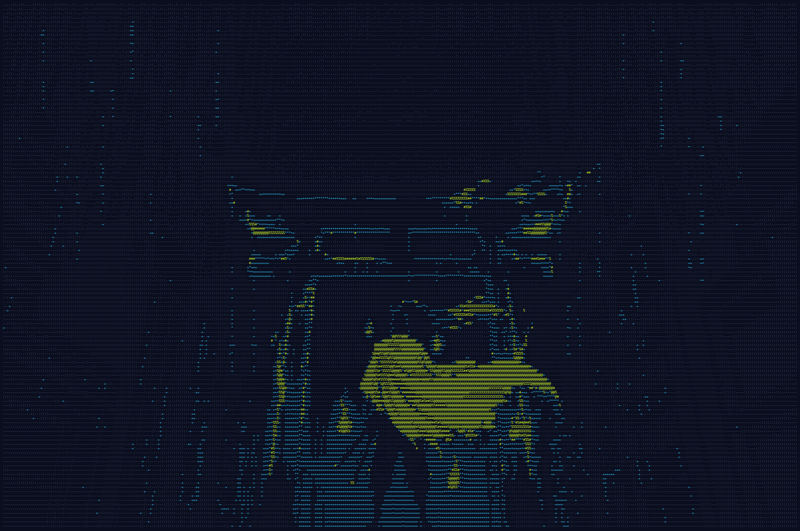

# Behind the scenes

How the art got made, and what it cost. Every image below is the version that
survived; the rejected generations are gone from the working tree, but they are
still in git history if you want to see the drift.

## The banner

The reaper under the torii, in ASCII. The source is
[banner_ascii.txt](banner_ascii.txt) at 400 by 122 characters;
[make_banner.py](make_banner.py) renders it in the game palette, with the light
strokes in slate, the mid tones in cyan and the heavy strokes in acid green.

## Canon: the files that govern the character

Two sheets answer different questions, and they disagree on purpose. See
[canon/README.md](../reference/canon/README.md) for the full drift checklist.

| | |
|---|---|
| [Design truth](../reference/canon/charsheet_design.png) | backswept horns, full-face mask, daisho at the left hip |
| [Rendering bar](../reference/canon/charsheet_quality.png) | hair banding and linework, but the horns curve wrong |
| [Key art](../reference/canon/keyart_design.png) | the mood piece the whole look is aimed at |
| [Unmasked](../reference/canon/unmasked.png) | what is under the hannya, for cutscenes that do not exist yet |

## The mega sheet

Every core animation in the game comes from one generation,
[sheet_mega.png](../reference/sheet_mega.png): six columns by five rows, sliced
by `art/player/slice_sheets.py` and assembled by `assemble_v2.py`. Getting one
clean sheet took several rounds. The haori kept vanishing from whole rows,
because dropout clusters by activity rather than at random, so the fix was to
restate the white haori inside every at-risk row description instead of once at
the top of the prompt.

A copy-job chain made it worse, not better. Asking the model to fix one row of
an existing sheet softened the rendering of every other row, so a fresh
generation with a better prompt beat editing a nearly-good one.

## The iai stance

The [FORCED ENTRY](../reference/iai_stance3.png) draw-slash needed a sheathed
batto stance that no existing sheet had. It took three rounds to land: the
horns curved forward, then the sword hand sat wrong. Round three passed, and
became the reference attached to the
[loop](../reference/iai_loop.png) and [enter](../reference/iai_enter.png) jobs
that produced the animation frames.

## Two prompting rules that were learned the hard way

- **Never attach a reference image for a new action.** The reference dominates
  the text. Attaching the combat sheet to a run-cycle prompt regenerated the
  combat sheet.
- **Layout instructions must come first and loudest.** Buried at the bottom they
  are ignored. Leading with "LAYOUT IS THE MOST IMPORTANT REQUIREMENT" works.

Both live in [PROMPTS.md](../reference/PROMPTS.md) alongside the prompts
themselves, and in the `spritedrift` skill that this project produced.

## Concept art for things not built yet

[BRUTE.4RCE](../reference/boss_bruteforce.png), the fail2ban boss of Region 1,
and the [title art](../reference/title_art.png) the title screen is built on.
